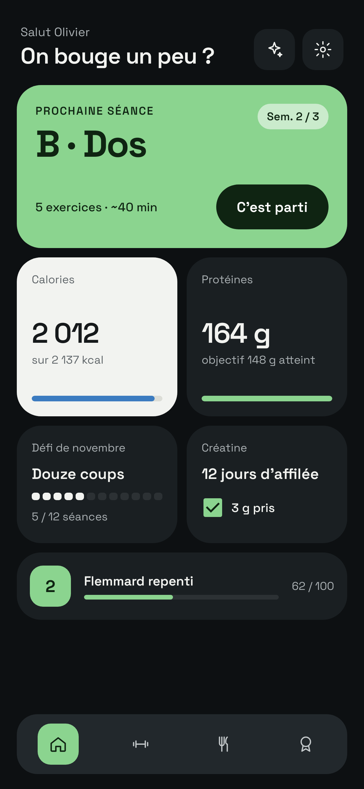
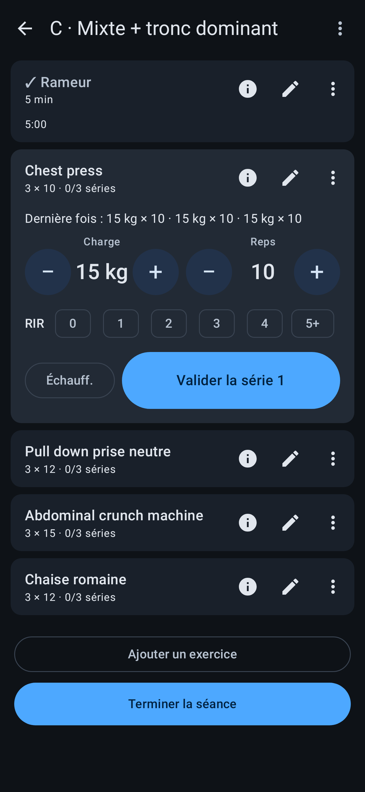
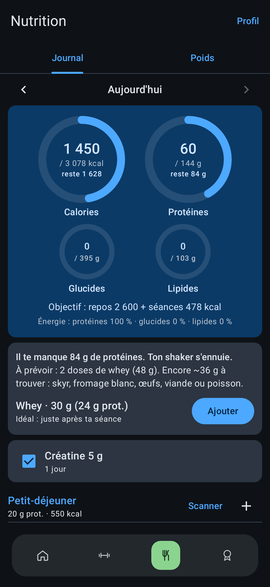
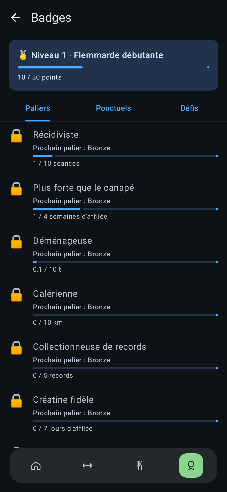
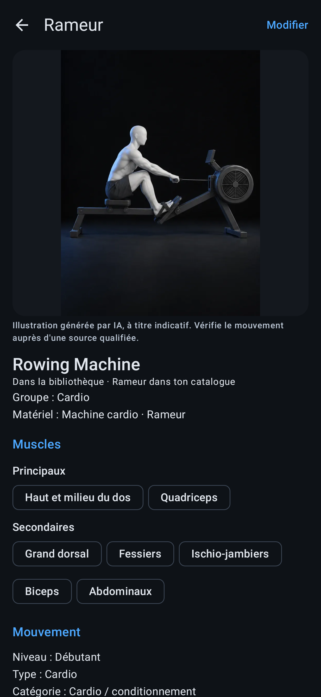

# GymFlemme

Application Android pour suivre ses séances de musculation en salle et ce qu'on mange, sans compte, sans pub et sans
réseau. Faite pour un usage personnel, partagée telle quelle avec quelques amis.

  
  
  
  
  

## Ce que fait l'app

**Sport**
- Séances par modèle (A / B / C…) en rotation, séries cochées une à une, minuteur de repos, supersets, remplacement d'une
  machine occupée, note « pour la prochaine fois ».
- Charges proposées d'après les séances précédentes, 1RM estimé, détection de plateau, conseil de semaine de décharge.
- Historique, records, volume par groupe musculaire, courbe de poids.
- Fréquence cardiaque en direct depuis une montre Bluetooth (profil standard) ou via Health Connect, zones et calories.
- Bibliothèque d'exercices illustrés, photos de vos propres machines.

**Nutrition**
- Journal des repas : scan de code-barres (Open Food Facts), table Ciqual embarquée, aliments et plats personnels.
- Objectif calories (prise de masse, maintien, sèche) ajusté aux séances, jauge de protéines, glucides et lipides.
- Compléments (créatine, vitamines…) avec rappel quotidien.

**Le reste**
- Accueil en tuiles, thèmes clair et sombre, raccourcis d'icône et widget.
- Badges, niveaux et défis du mois, sur un ton qui ne se prend pas au sérieux.
- Export du jour en Markdown, à coller dans l'assistant IA de votre choix pour un avis sur la séance.

## Installer

1. Sur le téléphone, ouvrez la [dernière version](https://github.com/ollivv-hash/GymFlemme/releases/latest) et
   téléchargez le fichier `gymflemme-x.y.z.apk`.
2. Ouvrez-le. Android demande d'autoriser l'installation depuis le navigateur (ou le gestionnaire de fichiers) :
   acceptez pour cette fois.
3. Play Protect peut avertir que l'app est inconnue : elle ne vient pas du Play Store, c'est normal. Choisissez
   « Installer quand même ».

Android 9 ou plus récent. Pour mettre à jour, installez simplement le nouvel APK par-dessus : vos données sont
conservées.

## Premier lancement

L'app démarre avec des **exemples** : trois modèles de séance (A, B, C) et les machines de l'auteur avec ses charges.
Adaptez-les à votre salle (⚙ → Catalogue des exercices, Modèles de séance, Rotation) et renseignez votre profil
(⚙ → Profil) pour que les calculs de calories et de protéines vous correspondent.

## Vie privée

- Toutes les données restent sur le téléphone. Pas de compte, pas de publicité, pas de statistiques d'usage.
- Le seul accès réseau : la recherche d'un code-barres **jamais scanné** auprès d'Open Food Facts (le code-barres
  seul est envoyé).
- Bluetooth et Health Connect ne servent qu'à lire la fréquence cardiaque, si vous l'activez.

## Sauvegarder ses données

⚙ → Réglages et sauvegarde : exporte tout dans un fichier JSON que vous pouvez ranger où vous voulez (Google Drive, par
exemple). La sauvegarde automatique réécrit ce fichier après chaque séance. Sur un nouveau téléphone, installez l'app
puis importez ce fichier.

Désinstaller l'app efface ses données : faites une sauvegarde avant.

## À savoir

- App personnelle, développée sur le temps libre : pas de support garanti, pas de calendrier de versions.
- Interface en français uniquement.
- Les conseils (charges, calories, protéines) sont des calculs simples, pas un avis médical ni celui d'un coach.

## Documentation

- [Historique des versions](docs/CHANGELOG.md)
- [Architecture et règles de fonctionnement](docs/ARCHITECTURE.md)
- [Compiler l'app](docs/DEVELOPPEMENT.md)

## Crédits

- Données nutritionnelles : [Ciqual 2025](https://ciqual.anses.fr/) (ANSES) et
  [Open Food Facts](https://world.openfoodfacts.org/) (ODbL).
- Illustrations d'exercices : domaine public (CC0), voir [third_party/open-exercise-illustrations](third_party/open-exercise-illustrations).
- Police Space Grotesk : SIL Open Font License, voir [third_party/space-grotesk](third_party/space-grotesk).

## Licence

Aucune licence : tous droits réservés. Le code est visible pour information ; il n'est pas autorisé de le réutiliser
ou de redistribuer l'app sans accord de l'auteur.
